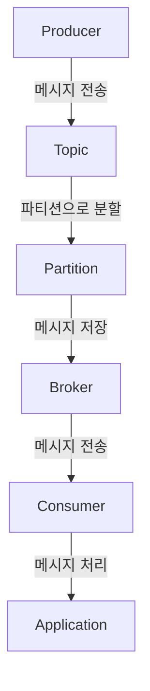
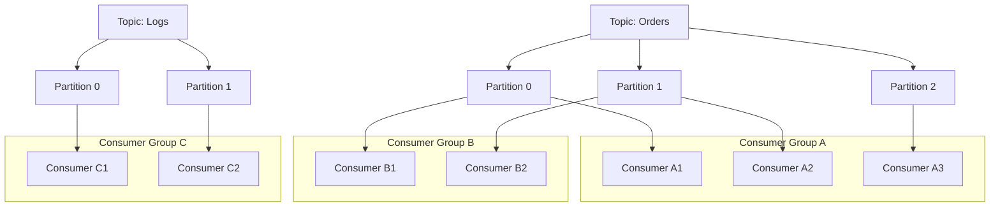
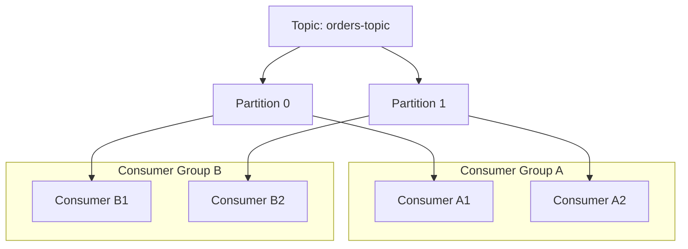

# 🚋 카프카 구조 및 동작 정리
## 🚗 카프카란?
### 카프카(Kafka)는 분산 스트리밍 플랫폼 또는 메시지 브로커 시스템이다.
### 주로 대규모 실시간 데이터 처리, 비동기 통신, 이벤트 기반 아키텍처에서 사용된다.
### 즉, Kafka 는 `대용량 데이터`를 빠르고 안정적으로 처리하고 전송하기 위한 `분산 메시지 큐` 시스템이다.

## 🚗 Kafka 의 주요 구성 요소
### 1. Producer
- `메시지`를 Kafka에 `전송`하는 역할
- 데이터를 `생성`하고, 특정 토픽에 메시지를 `게시`한다.
### 2. Broker (Kafka 서버)
- Kafka 서버의 `인스턴스`
- 메시지를 `저장`하고, 소비자에게 `전송`하는 역할
- 여러 개의 브로커가 클러스터를 형성하여 `확장성`과 `내결함성`을 제공한다.
- 브로커는 `파티션`을 통해 데이터를 분산 저장한다.
- 브로커는 `토픽`을 통해 메시지를 구분한다.
### 3. Topic
- 메시지를 `구분`하는 `카테고리` 또는 `채널`
- 즉, 메시지를 `논리적으로 그룹화`하는 단위
- 각 토픽은 여러 개의 `파티션`으로 나뉘어져 있다.
### 4. Partition
- 토픽의 `하위 단위`
- 각 파티션은 `순서가 보장된` 메시지의 `리스트`로 구성된다.
- 각 파티션은 `브로커`에 저장되며, `병렬 처리`를 가능하게 한다.
- 각 파티션은 `오프셋`을 통해 메시지의 순서를 관리한다.
- 각 파티션은 `리더`와 `팔로워`로 구성되어 있다.
### 5. Consumer
- Kafka에서 메시지를 `소비`하는 역할
- 특정 토픽의 메시지를 `구독`하고, 메시지를 `처리`한다.
- 소비자는 `컨슈머 그룹`을 통해 여러 개의 소비자가 협력하여 메시지를 처리할 수 있다.
### 6. Consumer Group
- 여러 소비자가 하나의 그룹으로 묶여, 메시지를 `병렬로 처리`할 수 있는 단위
- 각 컨슈머 그룹은 특정 토픽의 메시지를 `공유`하여 처리한다.
- 컨슈머 그룹 내의 각 컨슈머는 `파티션`을 `독점적으로` 소비한다.
- 컨슈머 그룹은 `오프셋`을 관리하여 메시지의 `처리 상태`를 추적한다.
### 7. Zookeeper
- Kafka 클러스터의 `메타데이터`를 관리하는 시스템
- 브로커의 `상태`, `토픽`, `파티션`, `컨슈머 그룹` 등의 정보를 저장하고 관리한다.
- Zookeeper는 Kafka의 `클러스터 관리`와 `구성 정보`를 제공한다.

## 🚙 구성요소 간 데이터 흐름

## 🚙 특이점이 온다

<hr>

### Example
```markdown
📁 Topic: 주문 내역
└ Partition 0: 주문 1~100
└ Partition 1: 주문 101~200
```
- Consumer Group A = 쿠팡 물류팀
  - Partition 0 → 직원 A1
  - Partition 1 → 직원 A2
- Consumer Group B = 배달의민족 물류팀
  - Partition 0 → 직원 B1
  - Partition 1 → 직원 B2

> 서로 다른 팀은 같은 문서를 "각자" 따로 처리하고, 팀 안에서는 1명이 1파트를 담당
<hr>


### * 같은 Partition을 여러 Consumer Group이 각자 읽는 것은 가능 (중복 소비)
### * 동일 Consumer Group 내에서는 하나의 Partition은 단 하나의 Consumer만 소비

## 📎 핵심 요약
#### ✔️ Consumer Group은 논리적인 묶음 (팀, 회사)
#### ✔️ Partition은 그룹 내에서 한 명의 Consumer와만 연결
#### ✔️ 서로 다른 Consumer Group은 같은 Partition을 중복 소비 가능